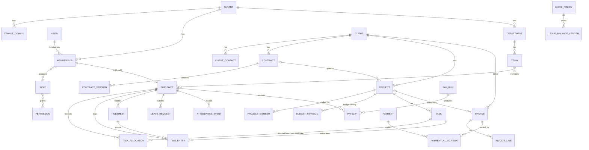

# Domain Model

Status: **Draft — Phase 0.** Fields are indicative; each module's spec in `docs/modules/` finalizes its tables before implementation.

Conventions for every tenant-owned table: `id uuid` (v7, time-ordered), `tenant_id uuid NOT NULL`, `created_at`, `updated_at`, `created_by`, `version int` (optimistic concurrency), unique `(tenant_id, id)`, FKs as `(tenant_id, x_id)`.

## 1. Entity relationships

## 2. Module ownership

Only the owning module writes its tables. Others read through its service.

| Module | Owns | Key relationships |
|---|---|---|
| identity | users, sessions, mfa factors, recovery codes, verification tokens | Global (not tenant-owned); a user may belong to several tenants. |
| tenancy | tenants, tenant_domains, memberships, invitations, tenant_settings | Root of isolation. |
| access | roles, permissions, role_permissions, membership_roles, scope grants | Permission keys defined in `packages/contracts`. |
| audit | audit_events (append-only) | Written by all modules via audit service. |
| people | employees, departments, teams, team_members, job_titles, reporting lines, employment_history | Employee ↔ membership is 1:1 for staff; a membership without employee = e.g. external accountant user. |
| clients | clients, client_contacts, client_notes | Bilingual legal name; duplicate detection on commercial registration no. / name. |
| contracts | contracts, contract_versions, templates, document numbering sequences | Belongs to client; may govern projects. |
| projects | projects, project_members, budget_revisions | Belongs to client (+ optional contract). Displays as "Engagement" if tenant chooses. |
| tasks | tasks, task_assignees, task_allocations, task_dependencies, task_comments, status_history | Belongs to project. |
| time | time_entries, timesheets, timesheet_approvals, timers | References task + employee. |
| leave | leave_types, leave_policies, leave_requests, leave_balance_ledger, holidays | Ledger, not a mutable balance column. |
| attendance | shifts, schedules, attendance_events, qr_sessions, corrections | Corrections are new records referencing originals. |
| payroll | pay_rule_sets (versioned), salary_records, pay_runs, payslips, payslip_lines | Highly restricted. Calculations snapshot all inputs. |
| billing | invoices, invoice_lines, credit_notes, payments, payment_allocations, numbering | Issued invoices immutable; corrections via credit notes. |
| notifications | notifications, preferences, deliveries, announcements | Recipient authorization checked at creation and at read. |
| files | file_objects (metadata), attachments (polymorphic links) | Binary in object storage, tenant-prefixed keys. |
| reports | (mostly read models / SQL views) | Runs through RLS. |

## 3. Hour measures — explicit definitions

These are different numbers and are never silently merged:

| Measure | Definition | Source of truth |
|---|---|---|
| **Project budgeted hours** | Hours approved for the project. Changes only through a `budget_revision` (who, when, why, old → new). | projects.budget_revisions (latest approved) |
| **Task estimate** | Optional planning guess for the task as a whole. Informational; does not consume budget. | tasks.estimated_hours |
| **Allocated hours** | Planned hours assigned to a specific employee on a specific task. **Consumes project budget capacity.** | task_allocations |
| **Unallocated hours** | Project budgeted − Σ active allocations. Never negative unless an authorized override exists. | computed |
| **Logged hours** | Time entries recorded by an employee (draft or submitted). | time_entries |
| **Approved hours** | Logged hours in an approved timesheet. **Actual consumption** for budget reporting. | time_entries where status = approved |
| **Billable hours** | Approved hours flagged billable. | time_entries.billable |
| **Billed hours** | Billable hours included on an issued invoice. | invoice_lines link |

Worked example: project budget 100h. Allocations A=20, B=15, C=10 ⇒ allocated 45, unallocated 55. Employee A then logs 12h, 10h approved ⇒ A's allocation remaining 10h of 20 (planned vs actual shown separately); project actual consumption 10h; budget remaining (actual basis) 90h, (planned basis) 55h.

Proposed rules (to confirm in Phase 6 spec):
- Cancelled task ⇒ unused allocation released back to project; approved time stays as actual.
- Completed task ⇒ unused allocation released (configurable).
- Rejected time ⇒ not counted as actual until corrected and re-approved.
- Over-allocation ⇒ blocked, unless user has `projects.budget.override` and gives a reason (audited).
- Budget reduced below current allocations ⇒ blocked, or requires override that flags affected allocations.
- Concurrency: allocation writes lock the project budget row (`SELECT … FOR UPDATE`) inside the transaction, then re-check capacity — two simultaneous assignments cannot both pass.

## 4. State machines (initial)

- Contract: `draft → in_review → approved → sent → signed → active → expired | terminated` (+ `rejected` back to draft).
- Project: `planned → active → on_hold → completed | cancelled`.
- Task: `backlog → ready → in_progress → in_review → completed` (+ `blocked` flag, `cancelled`).
- Timesheet: `draft → submitted → approved | rejected → (rejected → draft)`; approved edits require reopen permission + audit.
- Leave request: `draft → submitted → approved | rejected`; `approved → cancelled` (reverses ledger entry).
- Pay run: `draft → calculated → in_review → approved → paid` (+ `void` before paid). Preparer ≠ approver.
- Invoice: `draft → issued → partially_paid → paid`; `issued → overdue` (derived by date); `issued → void` (only with credit note / controlled process).

Transitions live in `packages/domain` as pure functions and are enforced in services; the DB stores the state and history.

## 5. Deletion, correction and history policy

| Record kind | Rule |
|---|---|
| Issued financial records (invoices, payments, payslips, approved pay runs) | **Never deleted or edited.** Corrected by new records (credit note, reversal, adjustment run) that reference the original. |
| Approved operational records (approved timesheets, approved leave, attendance) | Not edited in place; reopen/correction is a permissioned, audited action that keeps the previous values. |
| Master data with history (clients, projects, employees, contracts) | **Archived**, not deleted, once referenced by other records (`archived_at`, hidden from pickers, still visible in history). Hard delete only while unreferenced drafts. |
| Drafts and user content (draft tasks, comments, notes) | Hard delete allowed by the author/permission holder; audited if the parent is sensitive. |
| Personal data on request (privacy) | Anonymization of personal fields while keeping legally required financial/labour records; process designed with legal review. |

Soft deletion (`deleted_at` flags) is **not** used as a general mechanism; archiving is explicit and only on the entities above.

## 6. Activity timelines and communication history

- `activity_events` (owned by audit module, tenant-scoped): human-readable timeline entries per record (client, project, task, contract, invoice) generated from domain events, separate from the security audit log.
- Client communication history (calls, meetings, emails logged manually; email integration later) lives in the clients module as `client_interactions`, linked to contacts.

## 7. Expenses (planned module)

Project expenses (out-of-pocket costs, subcontractors, travel) owned by an `expenses` module: `expense_claims`, `expense_lines` (money + currency + receipt file), approval workflow `draft → submitted → approved | rejected → reimbursed`, optional re-billing to the client invoice. Feeds project cost and profitability. Scheduled after invoicing (roadmap Phase 12b).

## 8. GRC-specific domain (pending product decision)

Target customers are audit/risk/GRC firms. The ERP above manages *the firm's own operations*. A separate question is whether we also build *GRC delivery tooling* (risk registers, control libraries, audit programs, working papers, findings and remediation tracking) linked to engagements. See open question in `project-status.md`.
